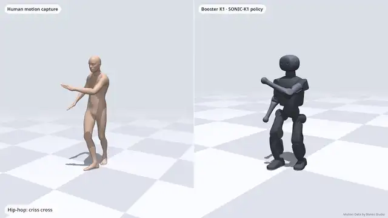
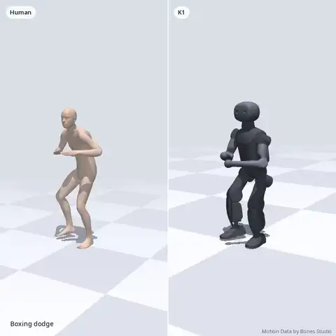
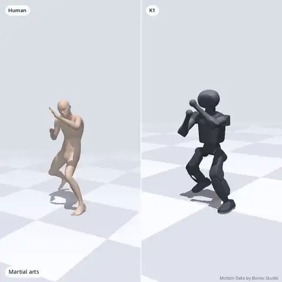
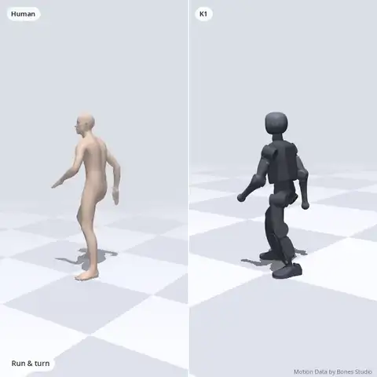

<h1 align="center">SONIC-K1</h1>
<p align="center"><b>NVIDIA's SONIC whole-body motion tracker, ported to the Booster K1 humanoid.</b><br>The first open-weights motion tracker for small humanoids.<br>
One policy, thousands of human motions, trained from scratch with under 1% of SONIC's compute.</p>

<p align="center"><b><a href="https://kyry.me/sonic-k1/">🌐 Project page &amp; videos</a> · <a href="#try-it-in-2-minutes-laptop-no-gpu">▶ Try it in 2 minutes</a> · <a href="sonic_k1_deploy/">🤖 Run it on a K1</a></b></p>

<p align="center">
  <a href="https://huggingface.co/Kyry10/sonic-k1"></a>
  <a href="https://kyry.me/sonic-k1/"></a>
  <a href="https://arxiv.org/abs/2511.07820"></a>
  
  
  
</p>

<p align="center"></p>

<p align="center">
  
  
  
</p>

> This is a fork of [NVlabs/GR00T-WholeBodyControl](https://github.com/NVlabs/GR00T-WholeBodyControl) that adds the
> **Booster K1** as a SONIC embodiment. Everything K1-specific is documented here and in [`docs/k1/`](docs/k1/).
> The original NVIDIA README is kept unchanged in [`README_SONIC_upstream.md`](README_SONIC_upstream.md).

**v1.0 (November 2026): tested on a real Booster K1.** v1.0 is fine-tuned for the real robot (Booster's deploy torque
limits on the legs, 0–40 ms of control latency) and runs on the K1's onboard computer with the robot app in
[`sonic_k1_deploy/`](sonic_k1_deploy/). Weights: [Kyry10/sonic-k1](https://huggingface.co/Kyry10/sonic-k1) (v0.1 in `v0.1/`).

## Results

MuJoCo sim-to-sim, all clips, 10 s, deterministic. SONIC's rule (root or end-effector height off > 0.25 m) / official-like rule.
*Real-robot* = Booster deploy torque limits + sensor noise + command latency.

| Condition | Unseen (1,985), v0.1 | Unseen (1,985), **v1.0** | Seen (2,000), **v1.0** |
|---|---|---|---|
| Nominal | 97.5% / 92.0% | **97.4% / 91.5%** | 98.4% / 96.8% |
| Real-robot, 20 ms latency | 95.5% / 85.9% | **97.1% / 90.6%** | 98.0% / 96.4% |
| Real-robot, 40 ms latency | 76.7% / 58.5% | **96.6% / 89.1%** | 97.9% / 95.1% |
| MPJPE-L, nominal | 15.4 mm | 17.1 mm | 16.4 mm |

Hold-out split of Bones-SEED; the exact clip lists are in [`docs/k1/bones_seed_splits.csv`](docs/k1/bones_seed_splits.csv).
Full protocol, Isaac Lab numbers and v0.1 details: [`docs/k1/eval.md`](docs/k1/eval.md).

**How it compares** (SONIC's own success rule, root or end-effector height off by > 0.25 m; others as published on the Unitree G1, so this is indicative):

| Benchmark | **SONIC-K1** (ours, K1; run by us) | SONIC (G1)\* | BeyondMimic (G1)\* | Any2Track (G1)\* |
|---|---|---|---|---|
| PHUMA | **92.3%** | 97.2% | 73.8% | 78.5% |
| Held-out mocap | **97.4%** | 98.5% | 82.0% | 61.6% |

\* *Reported in the SONIC paper (Luo et al., arXiv 2511.07820). We did not rerun these methods.*

Details and LAFAN1 are in [`docs/k1/eval.md`](docs/k1/eval.md).

**How much compute?** About 110 GPU-hours (100 for v0.1 + 9 for the v1.0 fine-tune), about 1% of what the SONIC paper used for the G1:

| | SONIC (G1, paper) | SONIC-K1 |
|---|---|---|
| GPU-hours | >9,000 | **~110** |
| Training motions | ~100M frames (700 h) | 9,991 clips |
| Unseen success, SONIC's rule | 98.5% (in-house test set) | 97.4% (MuJoCo) |


## Try it in 2 minutes (laptop, no GPU)
```bash
GIT_LFS_SKIP_SMUDGE=1 git clone --depth 1 --filter=blob:none --sparse https://github.com/Kyk0/sonic-k1 && cd sonic-k1
git sparse-checkout set gear_sonic/scripts examples/k1 gear_sonic/data/assets/robot_description   # ~30 MB instead of ~1 GB
pip install mujoco onnxruntime numpy "imageio[ffmpeg]" huggingface_hub     # Python 3.10+
hf download Kyry10/sonic-k1 onnx/policy_g1.onnx k1_plant.json --local-dir checkpoints/sonic-k1

python gear_sonic/scripts/play_k1.py                                         # live viewer (macOS: use mjpython)
python gear_sonic/scripts/play_k1.py --record demo.mp4
```
For training or the full benchmarks, clone the whole repo (`git clone https://github.com/Kyk0/sonic-k1`) instead.
The first command opens a MuJoCo window and plays all ten sample motions back to back, starting with shadow boxing.
The second one saves the same demo as a video you can share. For one clip, add `--motion examples/k1/motions/squat.npz`.
Ten sample motions ship in [`examples/k1/motions/`](examples/k1/motions/): `shadow_boxing`, `boxing_dodge`,
`scissors_jump`, `mountain_climber`, `high_knees`, `forward_lunge`, `squat`, `crouch_walk`, `injured_leg_jog`,
`exaggerated_walk`. They are SONIC-K1's own recorded motion on held-out clips it never trained on (no human motion
capture data); see the folder README for source and license.

### Your own motion
`play_k1.py` takes any `.npz` with `qpos` [T, 29] (root xyz, root quat wxyz, 22 joints in MuJoCo order) and `fps`.
To get one from a human clip (SMPL-X, BVH, or a phone video through a pose estimator such as GVHMR), retarget it to the K1 with
[UMR](https://github.com/hanyang9/UMR) using the settings in [`docs/k1/data.md`](docs/k1/data.md). The UMR output plays directly:
```bash
python gear_sonic/scripts/play_k1.py --motion my_move_k1.npz --record my_move.mp4
```
Made something fun? Share the video and tag **#SONICK1**.

### Reproduce the benchmarks
Batch evaluation in MuJoCo (all success rules, MPJPE, robustness knobs) needs the upstream SONIC environment and a K1 motion
library made with [`convert_k1_npz_to_motion_lib.py`](gear_sonic/data_process/convert_k1_npz_to_motion_lib.py):
```bash
hf download Kyry10/sonic-k1 --local-dir checkpoints/sonic-k1
python gear_sonic/scripts/eval_k1_mujoco.py \
    --checkpoint checkpoints/sonic-k1/sonic_k1_v1_actor.pt --onnx checkpoints/sonic-k1/onnx \
    --motion-dir <k1_motion_lib_dir> --out runs/mujoco --no-terminate
# real-robot condition: add --booster-effort-caps --latency-ms 40 --obs-noise
```

### Train your own
```bash
# Isaac Sim 5.1 / Isaac Lab, one H100 (80–96 GB); same setup as upstream training.md
python gear_sonic/train_agent_trl.py \
    +exp=manager/universal_token/all_modes/sonic_k1 \
    num_envs=16384 headless=True \
    ++manager_env.commands.motion.motion_lib_cfg.motion_file=<path/to/k1_motion_lib>
```
v1.0 real-robot fine-tune (resume from v0.1 with the `k1_real` robot: Booster torque limits, 0–40 ms delay ramped in
over 2,000 iterations, kp/kd ×U(0.9, 1.1), torque-near-limit penalty):
```bash
mkdir -p runs/legs && cp <your full v0.1-style training checkpoint>.pt runs/legs/last.pt   # actor + critic + optimizer
python gear_sonic/train_agent_trl.py \
    +exp=manager/universal_token/all_modes/sonic_k1_legs \
    num_envs=16384 headless=True ++resume=True ++experiment_dir=runs/legs \
    ++manager_env.commands.motion.motion_lib_cfg.motion_file=<path/to/k1_motion_lib> \
    ++manager_env.commands.motion.motion_lib_cfg.override_num_motions_to_load=1000000   # all clips on the GPU
# after a restart mid-ramp: K1_DELAY_RAMP_OFFSET=<env steps already done> keeps the delay where it was
# (the released actor-only .pt has no critic/optimizer, so fine-tuning from it starts the critic fresh)
```

Training on headless H100 servers? SONIC-K1 was trained with the setup in our [Isaac Lab on H100 guide](https://github.com/Kyk0/isaaclab-h100): physics-only Isaac Lab on shared, compute-only GPUs. A pre-converted K1 USD (the exact asset used for training) is at [Kyry10/booster-k1-usd](https://huggingface.co/datasets/Kyry10/booster-k1-usd).

You need your own access to [Bones-SEED](https://huggingface.co/datasets/bones-studio/seed). We do **not** redistribute
any motion data, raw or retargeted. See [`docs/k1/data.md`](docs/k1/data.md) for the retarget → QA → feasibility pipeline.

## What changed vs. upstream SONIC

- `gear_sonic/envs/manager_env/robots/k1.py`: K1 robot config, joint and body maps, IsaacLab↔MuJoCo order.
- K1 experiment config:
  - head-joint tracking term;
  - pushes and COM randomization ×0.7;
  - mass 0.9–1.3;
  - init std 0.5.
- MuJoCo sim-to-sim eval: the actor gives the same outputs as in Isaac Lab, 5 ms physics, 50 Hz policy. 99.0% of 200 unseen clips run without a fall.
- ONNX export (fused `policy_g1.onnx` + split encoder/decoder), with `--parity-onnx` to check it against PyTorch.
- Real-K1 plant (`k1_real`, v1.0): Booster deploy torque limits, `DelayedImplicitActuator` 0–40 ms with a ramp curriculum,
  gain randomization, torque-near-limit penalty (`sonic_k1_legs.yaml`).
- [`sonic_k1_deploy/`](sonic_k1_deploy/): robot app for the Booster SDK (motion menu, damping key, safety guards, MuJoCo and fake-SDK rehearsal).

See [`NOTICE`](NOTICE) for the complete list of modified files.

## Coming soon
- [x] **Real Booster K1 runs**: v1.0 runs on the physical robot (videos coming)
- [x] **Deployment controller**: an open runtime for the Booster SDK ([`sonic_k1_deploy/`](sonic_k1_deploy/))
- [ ] **Whole-body teleoperation**: drive the K1 live from a VR headset
- [ ] **Video to K1**: SMPL/video input, so you can film a move and the K1 does it
- [ ] **A bigger model**: trained on 62K motions (6× more)

## License and credits
- Code: Apache-2.0 (upstream NVIDIA license kept; our changes are listed in `NOTICE`).
- Weights: CC BY-NC 4.0 (see the [model card](https://huggingface.co/Kyry10/sonic-k1)).
- K1 model: BoosterRobotics/booster_assets, BSD-3-Clause.
- **Training data includes Motion Data by Bones Studio** ([bones.studio](https://bones.studio/)).
  Use of the underlying dataset is subject to the BONES Motion Capture Dataset License Agreement.

Built on [SONIC](https://arxiv.org/abs/2511.07820) by NVIDIA GEAR. Please cite it (and this repo, through
[`docs/k1/CITATION.cff`](docs/k1/CITATION.cff)) if this helps your work.

Made by [Kyrylo Kolesnichenko](https://kyry.me) at ATR Lab.
