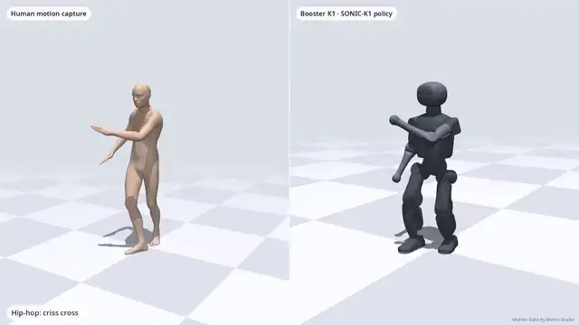
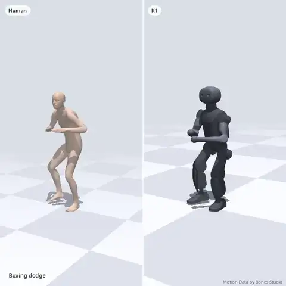
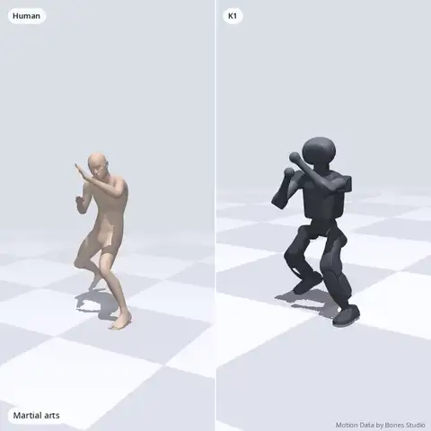
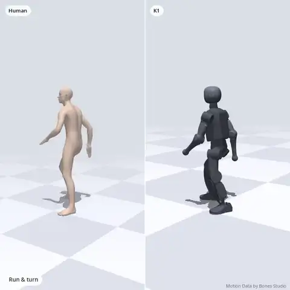

<h1 align="center">SONIC-K1</h1>
<p align="center"><b>NVIDIA's SONIC whole-body motion tracker, ported to the Booster K1 humanoid.</b><br>
One policy, thousands of human motions, trained from scratch on a single H100.</p>

<p align="center">
  <a href="https://huggingface.co/Kyry10/sonic-k1"></a>
  <a href="https://arxiv.org/abs/2511.07820"></a>
  
  
</p>

<!-- HERO: replace with media/hero.webp (or a GitHub-hosted mp4) once rendered -->
<p align="center"></p>

<p align="center">
  
  
  
</p>

> This is a fork of [NVlabs/GR00T-WholeBodyControl](https://github.com/NVlabs/GR00T-WholeBodyControl) that adds the
> **Booster K1** as a SONIC embodiment. Everything K1-specific is documented here and in [`docs/k1/`](docs/k1/).
> The upstream README is kept unchanged in [`README.md`](README.md).

## Results

| | Unseen (1,985 clips) | Seen (2,000 clips) |
|---|---|---|
| Success, official repo eval | **93.1%** | 98.5% |
| Success, SONIC paper rule (falls only) | **98.7%** | 98.8% |
| MPJPE-L / PA-MPJPE | **14.7 / 10.8 mm** | 15.2 / 11.2 mm |

Isaac Lab, 10 s windows, deterministic. Hold-out split of Bones-SEED. Full protocol: [`docs/k1/eval.md`](docs/k1/eval.md).

**How much compute?** 1× H100 for under a week (~135 GPU-hours), ~1.5% of what the SONIC paper used for the G1:

| | SONIC (G1, paper) | SONIC-K1 |
|---|---|---|
| GPUs | 128 | **1** |
| Training motions | ~100M frames (700 h) | 9,991 clips |
| Unseen success (fall rule) | — | 98.7% (Isaac), 99.0% (MuJoCo) |


## Get started

### 1. Play the policy in MuJoCo (CPU is fine)
```bash
git clone https://github.com/Kyk0/sonic-k1 && cd sonic-k1
# same environment as upstream SONIC (see README.md → Installation), plus mujoco + onnxruntime
huggingface-cli download Kyry10/sonic-k1 --local-dir checkpoints/sonic-k1
python gear_sonic/scripts/eval_k1_mujoco.py \
    --checkpoint checkpoints/sonic-k1/sonic_k1_it50000_actor.pt \
    --onnx checkpoints/sonic-k1/onnx \
    --motion-dir <k1_motion_lib_dir> --out runs/mujoco --render-dir runs/mujoco/qpos
```

### 2. Bring your own motion
Retarget any SMPL/BVH clip to K1 with [UMR](https://github.com/hanyang9/UMR), using
UMR's Booster K1 example config, switched to the official K1 model (see [`docs/k1/data.md`](docs/k1/data.md)), then convert it with
[`gear_sonic/data_process/convert_k1_npz_to_motion_lib.py`](gear_sonic/data_process/convert_k1_npz_to_motion_lib.py).
Video → motion works too, through any monocular human-pose estimator (e.g. GVHMR) followed by UMR.

### 3. Train your own
```bash
# Isaac Sim 5.1 / Isaac Lab, one H100 (80–96 GB); same setup as upstream training.md
python gear_sonic/train_agent_trl.py \
    +exp=manager/universal_token/all_modes/sonic_k1 \
    num_envs=16384 headless=True \
    ++manager_env.commands.motion.motion_lib_cfg.motion_file=<path/to/k1_motion_lib>
```
You need your own access to [Bones-SEED](https://huggingface.co/datasets/bones-studio/seed). We do **not** redistribute
any motion data, raw or retargeted. See [`docs/k1/data.md`](docs/k1/data.md) for the retarget → QA → feasibility pipeline.

## What changed vs. upstream SONIC

- `gear_sonic/envs/manager_env/robots/k1.py`: K1 robot config, joint and body maps, IsaacLab↔MuJoCo order.
- K1 experiment config:
  - head-joint tracking term;
  - pushes and COM randomization ×0.7;
  - mass 0.9–1.3;
  - init std 0.5.
- MuJoCo sim-to-sim eval: the actor gives the same outputs as in Isaac Lab, 5 ms physics, 50 Hz policy. 99.0% of 200 unseen clips run without a fall.
- ONNX export (fused `policy_g1.onnx` + split encoder/decoder), with `--parity-onnx` to check it against PyTorch.

See [`NOTICE`](NOTICE) for the complete list of modified files.

## Limitations (please read)
- **Simulation only.** It has not been run on a physical K1. If you try, use a gantry and start with slow motions.
- **Legs are conservative on wild dances.** Foot lift on out-of-distribution dances is ~31% of the reference.
- **Still fails on** deep moving crouches, ground rolls, and motions that need props or terrain.
- **SMPL encoder untrained:** feed K1 joint-space references.

## Roadmap
- [ ] Real-K1 deployment (Booster SDK)
- [ ] Larger data window (62K feasible clips)
- [ ] Foot-lift fix + root-drift A/B
- [ ] SMPL / video encoder

## License and credits
- Code: Apache-2.0 (upstream NVIDIA license kept; our changes are listed in `NOTICE`).
- Weights: CC BY-NC 4.0 (see the [model card](https://huggingface.co/Kyry10/sonic-k1)).
- K1 model: BoosterRobotics/booster_assets, BSD-3-Clause.
- **Training data includes Motion Data by Bones Studio** ([bones.studio](https://bones.studio/)).
  Use of the underlying dataset is subject to the BONES Motion Capture Dataset License Agreement.

Built on [SONIC](https://arxiv.org/abs/2511.07820) by NVIDIA GEAR. Please cite it (and this repo, through
[`docs/k1/CITATION.cff`](docs/k1/CITATION.cff)) if this helps your work.

Made by [Kyrylo Kolesnichenko](https://kyry.me) at Kent State University.
